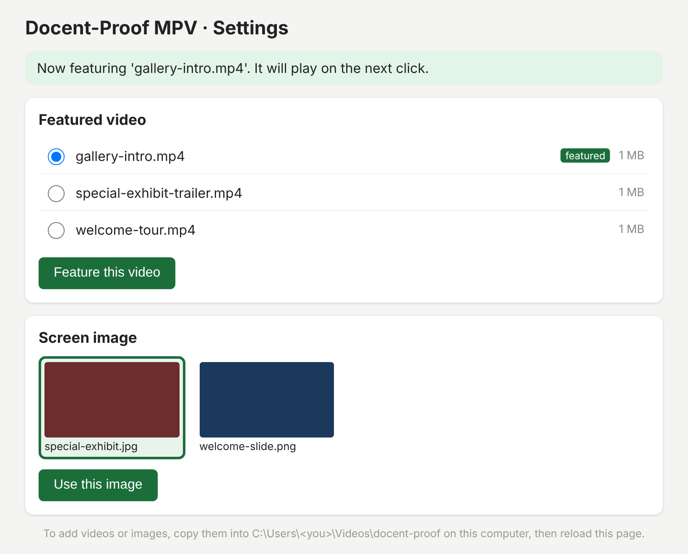
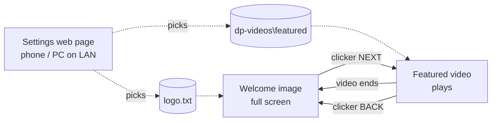

# Docent-Proof MPV

**A K.I.S.S. (keep it simple) video player for pre-exhibition presentations.**

Docent-Proof MPV does one job: before a group enters the exhibition, it shows a welcome image and plays one intro video when the docent clicks. Docents use one button on a Bluetooth clicker, and there are no menus or controls on screen. Staff swap the featured video and welcome image from a web page advertised on the network.

- **Idle:** a full-screen welcome image (your logo or title slide).
- **Click "Next":** the featured video plays full screen.
- **Video ends:** the welcome image comes straight back and waits for the next group.

It runs on Windows 10/11 using [mpv](https://mpv.io) (a free, portable video player) plus a few scripts that rely only on what ships with Windows. There's no installer, no service, no database and no runtime to keep updated.

Keeping it simple is the point. There are no playlists, schedules or remote uploads. Featured video is changed manually according to Exhibitions team preference.



---

## Contents

- [How it works](#how-it-works)
- [Requirements](#requirements)
- [Installation](#installation)
- [Folder layout](#folder-layout)
- [Configuration](#configuration)
- [Daily use](#daily-use)
- [Updating](#updating)
- [Uninstalling](#uninstalling)
- [Troubleshooting](#troubleshooting)
- [For maintainers](#for-maintainers)
- [Why mpv and not VLC?](#why-mpv-and-not-vlc)
- [License](#license)

---

## How it works



There are two independent pieces:

| Piece             | What it is                               | What it does                                                                                                                                                                    |
| ----------------- | ---------------------------------------- | ------------------------------------------------------------------------------------------------------------------------------------------------------------------------------- |
| **Player**        | mpv + `mpv-config/scripts/docent.lua`    | Shows the welcome image, plays the featured video on NEXT, returns to the image when the video ends. Re-reads the media folders on every click, so changes apply right away.    |
| **Settings page** | `config-server.ps1` (Windows PowerShell) | A small web server on port 8080. Moves the chosen video into `dp-videos\featured` and moves the previous one back to `dp-videos`. Saves the chosen welcome image to `logo.txt`. |

The two pieces share nothing except the media folder, so either one can be restarted without affecting the other.

**Features**

- Works with any Bluetooth/USB clicker that sends PageDown/PageUp or arrow keys (most do). The keys can be remapped.
- NEXT is ignored while a video is playing, so a nervous double-click can't restart it. BACK stops the video.
- The welcome image updates on screen within about 3 seconds of a change on the settings page.
- Featured-video swaps are safe: if any move fails, the files are put back where they were.
- Optional PIN for the settings page, and the firewall rule only allows devices on the local network.
- Starts automatically at login, restarts the player if it ever crashes, and keeps the screen from sleeping.
- No mouse cursor, menus or on-screen controls, and stray keypresses don't do anything.

---

## Requirements

|                  |                                                                                                   |
| ---------------- | ------------------------------------------------------------------------------------------------- |
| **OS**           | Windows 11 or Windows 10 (64-bit)                                                                 |
| **Player**       | [mpv for Windows](https://mpv.io/installation/), 64-bit build (downloaded separately, see step 2) |
| **Scripting**    | Windows PowerShell 5.1, which is built into Windows                                               |
| **Admin rights** | Only once, for `setup.bat`                                                                        |
| **Network**      | Only needed for the settings page. Staff devices must be on the same local network.               |
| **Clicker**      | Any presentation remote that acts as a keyboard                                                   |

**Recommended media:** MP4 (H.264 video + AAC audio) at the display's resolution plays smoothly on almost any PC. Welcome images should be JPG or PNG at the screen's resolution (e.g. 1920×1080).

---

## Installation

### 1. Download this project

1. On GitHub, click **Code → Download ZIP**.
2. **Before extracting**, right-click the ZIP, choose **Properties**, tick **Unblock** if it's shown, and click **OK**. This stops Windows from showing security warnings on every script.
3. Extract it to a permanent place, for example:
   
   ```
   C:\Users\<you>\docent-proof-mpv\
   ```
   
   This guide calls that the **app folder**. Don't put it in Downloads or on the Desktop, because they tend to get cleaned up.

Or clone it with git:

```powershell
git clone https://github.com/<owner>/docent-proof-mpv.git $env:USERPROFILE\docent-proof-mpv
```

### 2. Add mpv

1. Go to **https://mpv.io/installation/**, find the **Windows** section and open one of the listed builds.
2. Download the latest **64-bit** build. The file name usually contains `x86_64`. Pick the `-v3` variant only if the PC is fairly new (2015 or later).
3. Extract it (use [7-Zip](https://www.7-zip.org/) for `.7z` files) **into the app folder's `mpv` subfolder**, so that this file exists:
   
   ```
   <app folder>\mpv\mpv.exe
   ```

You don't need to run mpv's own installer scripts. The launcher points mpv at this project's settings.

### 3. Run the one-time setup

Double-click **`setup.bat`** and click **Yes** when Windows asks for administrator permission. It does four things:

| Step                                                                                | Why                                                                                   |
| ----------------------------------------------------------------------------------- | ------------------------------------------------------------------------------------- |
| Reserves `http://+:8080/` for the settings page (`netsh http add urlacl`)           | Lets the settings page accept connections from other devices without running as admin |
| Adds the firewall rule **"Docent-Proof MPV Panel"** (TCP 8080, *local subnet only*) | Lets phones and PCs on the same network reach the page                                |
| Adds a **"Docent-Proof MPV"** shortcut to the all-users Startup folder              | The player starts at every login                                                      |
| Turns off the screen timeout and sleep while plugged in (`powercfg`)                | The welcome image stays up all day                                                    |

You can run it again at any time, for example after changing the port.

### 4. Add media

The media folders are created automatically the first time the player runs, but you can create them yourself:

```
C:\Users\<you>\Videos\docent-proof\
├─ welcome-slide.png           ← welcome images (one is shown; pick on the settings page)
├─ special-exhibit.jpg
└─ dp-videos\
   ├─ welcome-tour.mp4         ← video library
   ├─ special-exhibit-trailer.mp4
   └─ featured\
      └─ gallery-intro.mp4     ← THE featured video (keep exactly one here)
```

Put **at least one image** in `docent-proof\` and **one video** in `dp-videos\featured\`.

### 5. Start it

Double-click **`start-docent.bat`**, or log out and back in. You should see:

1. The welcome image, full screen.
2. Press **PageDown** (or Right arrow) and the featured video plays.
3. When it ends, the welcome image comes back.

Press **Ctrl+I** on the player to show the settings page address, then open it on your phone.

### 6. Pair the clicker

Pair it in **Settings → Bluetooth & devices** like any other Bluetooth device (USB-dongle clickers just plug in). Press its forward/back buttons to test. If nothing happens, see [Clicker keys](#clicker-keys).

---

## Folder layout

**App folder** (this repository):

```
docent-proof-mpv\
├─ start-docent.bat          Starts the settings page + player. Main settings at the top.
├─ stop-panel.bat / .ps1     Turns the settings page off (the player keeps running).
├─ setup.bat / setup.ps1     One-time setup (admin).
├─ config-server.ps1         The settings web page.
├─ config-server.log         Created at runtime: settings page activity and errors.
├─ mpv\                      Put mpv.exe and its files here (not included in this repo).
├─ mpv-config\
│  ├─ mpv.conf               Player behavior (full screen, volume, etc.).
│  ├─ mpv.log                Created at runtime: player log, overwritten at each start.
│  ├─ script-opts\docent.conf  Clicker keys and other options.
│  └─ scripts\docent.lua     The image → video → image logic.
└─ docs\                     Images for this README.
```

**Media folder** (`%USERPROFILE%\Videos\docent-proof` by default):

| Path                               | Contents                                                                          |
| ---------------------------------- | --------------------------------------------------------------------------------- |
| `docent-proof\`                    | Welcome images (`.jpg .jpeg .png .bmp .gif .webp .tif .tiff`)                     |
| `docent-proof\logo.txt`            | Created automatically: the file name of the chosen welcome image                  |
| `docent-proof\config-address.txt`  | Created automatically: the settings page address(es)                              |
| `docent-proof\dp-videos\`          | Video library (`.mp4 .m4v .mov .mkv .webm .avi .wmv .mpg .mpeg .ts`)              |
| `docent-proof\dp-videos\featured\` | The one video that plays. If there are several, the first alphabetically is used. |

---

## Configuration

### Launcher settings (`start-docent.bat`)

Open `start-docent.bat` in Notepad. The settings are at the top:

```bat
set "DOCENT_FOLDER=%USERPROFILE%\Videos\docent-proof"
set "PANEL_PORT=8080"
set "PANEL_PIN="
```

| Setting         | Default                             | Notes                                                                                                       |
| --------------- | ----------------------------------- | ----------------------------------------------------------------------------------------------------------- |
| `DOCENT_FOLDER` | `%USERPROFILE%\Videos\docent-proof` | Where the media lives. Can be any local folder, e.g. `D:\Docent`.                                           |
| `PANEL_PORT`    | `8080`                              | Port for the settings page. **Run `setup.bat` again after changing it** (it reads the port from this file). |
| `PANEL_PIN`     | *(empty)*                           | Set a number (e.g. `4821`) to require a PIN before saving changes. Leave empty for no PIN.                  |

Restart with `stop-panel.bat`, then press Ctrl+Q on the player and run `start-docent.bat` again, so the changes take effect.

### Player options (`mpv-config\script-opts\docent.conf`)

Remove the `#` in front of a line to change that setting:

| Option         | Default                                           | Meaning                                                       |
| -------------- | ------------------------------------------------- | ------------------------------------------------------------- |
| `next_keys`    | `PGDWN,RIGHT,DOWN,SPACE,ENTER,KP_ENTER,MBTN_LEFT` | Keys/buttons that start the video                             |
| `back_keys`    | `PGUP,LEFT,UP`                                    | Keys that stop the video and return to the image              |
| `poll_seconds` | `3`                                               | How often to check for a new welcome image while it's showing |

### Player behavior (`mpv-config\mpv.conf`)

Standard [mpv options](https://mpv.io/manual/stable/#options). The ones you're most likely to change:

| Line                        | Meaning                                                                                            |
| --------------------------- | -------------------------------------------------------------------------------------------------- |
| `volume=100`                | Starting volume (0–100). Windows volume still applies on top.                                      |
| `fullscreen=yes`            | Full screen on start.                                                                              |
| `hwdec=auto-safe`           | Hardware video decoding. Set to `no` if videos show glitches or green frames.                      |
| `cursor-autohide=always`    | Hides the mouse pointer over the player.                                                           |
| `input-default-bindings=no` | Turns off all of mpv's built-in shortcuts so stray keys do nothing. Only this project's keys work. |

To show the player on a **second monitor** (for example a projector), add `screen=1` and `fs-screen=1` (`0` is the first display).

### Clicker keys

Most clickers send **PageDown/PageUp**, which work out of the box. To find out what yours sends:

1. Click on the player screen so it has focus.
2. Press **Ctrl+K**. For 20 seconds, every button press shows its key name on screen instead of doing anything.
3. Add those names to `next_keys` / `back_keys` in `script-opts\docent.conf` and restart the player.

> Many clickers also have a "blank screen" button (sends `b` or `.`) and a "start/stop slideshow" button (sends `F5`/`Esc`). These do nothing by default. Add them to a key list if you want them to.

### Network and security

- The firewall rule only accepts connections from the **local subnet**. Nothing is exposed to the internet.
- Anyone on the same network can open the settings page. Set `PANEL_PIN` if that network includes the public, e.g. guest Wi-Fi on the same subnet.
- Ask IT for a **reserved/static IP address** for the player PC so the settings page address never changes, then bookmark it on staff phones. `http://<PC-name>:8080/` often works too.
- The settings page can only choose among files already in the media folders. It can't upload, delete or read files anywhere else.

---

## Daily use

### Controls

| Input                                                                    | Action                                                                                                |
| ------------------------------------------------------------------------ | ----------------------------------------------------------------------------------------------------- |
| Clicker **NEXT** (PageDown / Right / Down / Space / Enter / mouse click) | Play the featured video. Ignored while a video is already playing.                                    |
| Clicker **BACK** (PageUp / Left / Up)                                    | Stop the video and return to the welcome image                                                        |
| **Ctrl+I**                                                               | Show the settings page address on screen for 15 seconds                                               |
| **Ctrl+M**                                                               | Minimize the player to use other programs (or use Alt+Tab). Click it on the taskbar to bring it back. |
| **Ctrl+K**                                                               | Clicker key test (20 seconds)                                                                         |
| **Ctrl+Q**                                                               | Quit the player. Use `start-docent.bat` to bring it back.                                             |

> **Note:** The clicker only controls the player while the player is the active window. After using another program, **click once on the player screen** before handing the clicker back.

### Changing the featured video or welcome image

1. On a phone or PC on the same network, open `http://<player-PC-IP>:8080/`. On the player PC itself, use `http://localhost:8080/`.
2. **Featured video:** select one and press **Feature this video**. It plays on the next click.
3. **Welcome image:** select one and press **Use this image**. The screen updates within a few seconds.

If a video is playing when you change the featured video, Windows may refuse to move it because it's in use. Wait for it to end, or press BACK, then try again.

### Adding or removing media

Copy new files into the media folders on the player PC (File Explorer, a USB drive, or a network share of the `docent-proof` folder), then reload the settings page. To remove a file, delete it from the folder. Don't delete the file that's currently playing.

### Turning the settings page off and on

|                    |                                                                                                                           |
| ------------------ | ------------------------------------------------------------------------------------------------------------------------- |
| `stop-panel.bat`   | Turns the settings page **off**. The player keeps running.                                                                |
| `start-docent.bat` | Turns it back **on**. If the player is already open, only the settings page is started, so you don't get a second player. |
| Next login         | The settings page turns on automatically.                                                                                 |

Once started, the settings page keeps running even if the player is closed, until `stop-panel.bat`, logout or restart.

---

## Updating

1. Run `stop-panel.bat` and press **Ctrl+Q** on the player.
2. Replace the scripts in the app folder with the new version (`git pull`, or download the ZIP again and copy over it). The `mpv\` folder and your media aren't touched.
3. If you changed `start-docent.bat` or the files in `mpv-config\`, copy your changes back in.
4. Run `start-docent.bat`.

To update mpv itself, replace the contents of `mpv\` with a newer build.

---

## Uninstalling

Quit the player (**Ctrl+Q**) and run `stop-panel.bat`. Then, in an **administrator** PowerShell:

```powershell
netsh http delete urlacl url=http://+:8080/
Remove-NetFirewallRule -DisplayName 'Docent-Proof MPV Panel'
Remove-Item "$env:ProgramData\Microsoft\Windows\Start Menu\Programs\StartUp\Docent-Proof MPV.lnk"
```

Then delete the app folder. Your media folder is left alone. To restore sleep settings, use **Settings → System → Power**.

---

## Troubleshooting

<details>
<summary><b>The settings page doesn't open from a phone</b></summary>

- Check it's running on the player PC: open `http://localhost:8080/` there.
- The phone must be on the **same network and subnet**. Guest Wi-Fi often isolates devices.
- Run `setup.bat` again. If `config-server.log` says *"Falling back to localhost only"*, setup hasn't been run (or was run with a different port).
- Check the address with **Ctrl+I** on the player, or in `docent-proof\config-address.txt`.
- Corporate security software can block inbound connections even with the Windows rule. Ask IT to allow TCP 8080 from the local subnet.
  
  </details>

<details>
<summary><b>The clicker does nothing</b></summary>

- Click once on the player screen. Another window probably has focus.
- Check the clicker is paired/connected and has battery.
- Use **Ctrl+K** to see which keys it sends, and add them to `script-opts\docent.conf`.
  
  </details>

<details>
<summary><b>Black screen with "No image found"</b></summary>

Put a JPG/PNG directly in the `docent-proof\` folder (not a subfolder). Check `DOCENT_FOLDER` in `start-docent.bat`.

</details>

<details>
<summary><b>"No featured video is set"</b></summary>

Feature one on the settings page, or copy a video into `dp-videos\featured\`. Check the file type is on the supported list.

</details>

<details>
<summary><b>Video stutters, is black, or has green glitches</b></summary>

Set `hwdec=no` in `mpv.conf`. If it still struggles, re-encode the video to H.264 MP4 at 1080p (e.g. with HandBrake's "Fast 1080p30" preset). Check `mpv-config\mpv.log` for errors.

</details>

<details>
<summary><b>"Couldn't move the file – the video is probably playing"</b></summary>

Windows locks a file while it's open. Wait for the video to end, or press BACK, then try again.

</details>

<details>
<summary><b>Windows shows "Windows protected your PC" or a security warning</b></summary>

The files were blocked when downloaded. Quit everything, right-click each `.bat`/`.ps1` file → **Properties** → **Unblock**. Or in PowerShell, from the app folder: `Get-ChildItem -Recurse | Unblock-File`.

</details>

<details>
<summary><b>The player doesn't start at login</b></summary>

Check the shortcut exists at `C:\ProgramData\Microsoft\Windows\Start Menu\Programs\StartUp\Docent-Proof MPV.lnk`. Run `setup.bat` again if not. Also check `mpv\mpv.exe` exists.

</details>

<details>
<summary><b>Port 8080 is already used by something else</b></summary>

Change `PANEL_PORT` in `start-docent.bat` (e.g. `8090`), run `setup.bat` again, then restart.

</details>

**Logs:** `config-server.log` (app folder) for the settings page. `mpv-config\mpv.log` for the player.

---

## For maintainers

### File reference

| File                            | Role                                                                                                                                                                                                                                                                                                                                                                                            |
| ------------------------------- | ----------------------------------------------------------------------------------------------------------------------------------------------------------------------------------------------------------------------------------------------------------------------------------------------------------------------------------------------------------------------------------------------- |
| `start-docent.bat`              | Starts `config-server.ps1` hidden, then mpv with `--config-dir=mpv-config` and `--script-opts=docent-base_dir=…`. Restarts mpv when it exits with a non-zero code. Ctrl+Q exits with `0`, which ends the loop. Skips launching mpv if `mpv.exe` is already running.                                                                                                                             |
| `mpv-config/scripts/docent.lua` | State machine with `image` and `video` modes. NEXT runs `loadfile <video> replace` then `loadfile <image> append`, so mpv moves straight to the image at end of file with no black gap. Mode is tracked by `playlist-pos` (0 = video) rather than by comparing paths, because mpv on Windows can report paths with different slashes. A periodic timer reloads the image if `logo.txt` changes. |
| `config-server.ps1`             | `System.Net.HttpListener` on `http://+:<port>/`. It falls back to `localhost` if the URL reservation is missing. Routes: `GET /`, `GET /image?f=<name>`, `POST /feature`, `POST /logo`. Only accepts names that are in the current folder listing, which blocks path traversal. Moves are rolled back on failure. Writes `config-address.txt` and `config-server.log`.                          |
| `stop-panel.ps1`                | Finds `powershell.exe` processes whose command line contains `config-server.ps1` (via `Win32_Process`) and stops them.                                                                                                                                                                                                                                                                          |
| `setup.ps1`                     | Elevates itself, reads `PANEL_PORT` from `start-docent.bat`, then sets up the URL reservation, firewall rule, Startup shortcut and power settings.                                                                                                                                                                                                                                              |

### Conventions

- **Windows PowerShell 5.1 compatible.** No PowerShell 7-only syntax, and scripts stay **ASCII-only**, because 5.1 reads BOM-less files as ANSI.
- **CRLF line endings** for `.bat`/`.ps1`/`.lua`/`.conf`. `.gitattributes` enforces this, because `cmd.exe` can mis-handle `goto` labels in LF-only batch files.
- Don't name PowerShell helper functions with single letters. For example, `h` is a built-in alias for `Get-History` and takes precedence over a function called `H`.

### Testing without Windows

The Lua logic can be tested headless on Linux with mpv ≥ 0.37 by sending simulated key presses over the IPC socket:

```bash
mpv --config-dir=mpv-config --vo=null --ao=null --input-ipc-server=/tmp/mpvsock \
    --script-opts=docent-base_dir=/path/to/test-media &
echo '{"command":["keypress","PGDWN"]}' | socat - /tmp/mpvsock
echo '{"command":["get_property","path"]}' | socat - /tmp/mpvsock
```

`config-server.ps1` runs under PowerShell 7 on Linux/macOS for testing (`pwsh ./config-server.ps1 -BaseDir /path -Port 8099`). It falls back to listing IPs through .NET when `Get-NetIPAddress` isn't available.

---

## Why mpv and not VLC?

|               | mpv                                                                        | VLC                                                                  |
| ------------- | -------------------------------------------------------------------------- | -------------------------------------------------------------------- |
| Footprint     | Single portable folder, no installer                                       | Installer, larger, plugins                                           |
| On-screen UI  | None when configured (no menus, controller or title bar)                   | Fullscreen controller and pop-ups that need several settings to hide |
| Scripting     | Built-in Lua, so the image → video → image loop runs **inside** the player | Needs an external controller over its HTTP/RC interface              |
| Configuration | One plain-text file, kept in this repo                                     | Preferences stored in the user's profile                             |

Both are free and open source. mpv makes the "kiosk" behavior simpler and more reliable.

---

## License

This project is released under the [MIT License](LICENSE).

**mpv is not included** in this repository. It's a separate project licensed under GPLv2+/LGPLv2.1+ (see [mpv.io](https://mpv.io) and its [source](https://github.com/mpv-player/mpv)). Download it yourself as described in [Installation](#2-add-mpv).
